<h1 align="center">Hi 👋, I'm Naww</h1>
<h3 align="center">A passionate frontend developer from Indonesia</h3>

- 📫 How to reach me **adzkanawwaf71@gmail.com**

<h3 align="left">Connect with me:</h3>

<h3 align="left">Languages and Tools:</h3>

           

  <picture>
    <source media="(prefers-color-scheme: dark)" srcset="https://raw.githubusercontent.com/nawwir151/nawwir151/output/pacman-contribution-graph-dark.svg" />
    <source media="(prefers-color-scheme: light)" srcset="https://raw.githubusercontent.com/nawwir151/nawwir151/output/pacman-contribution-graph.svg" />
    
  </picture>

